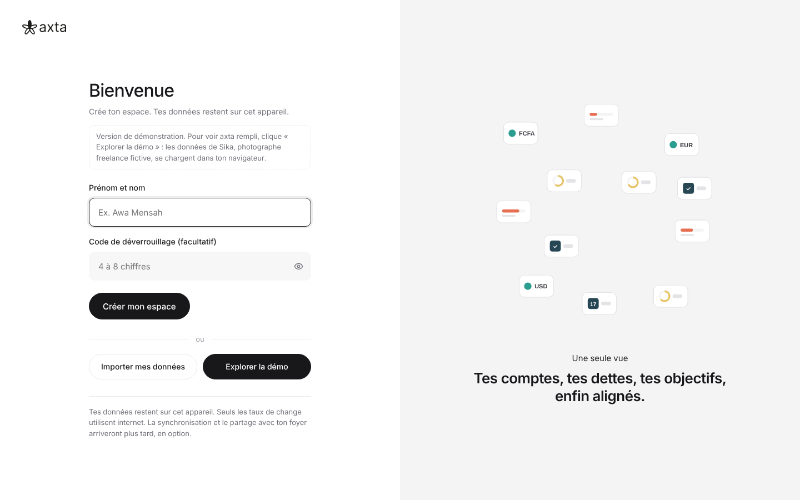
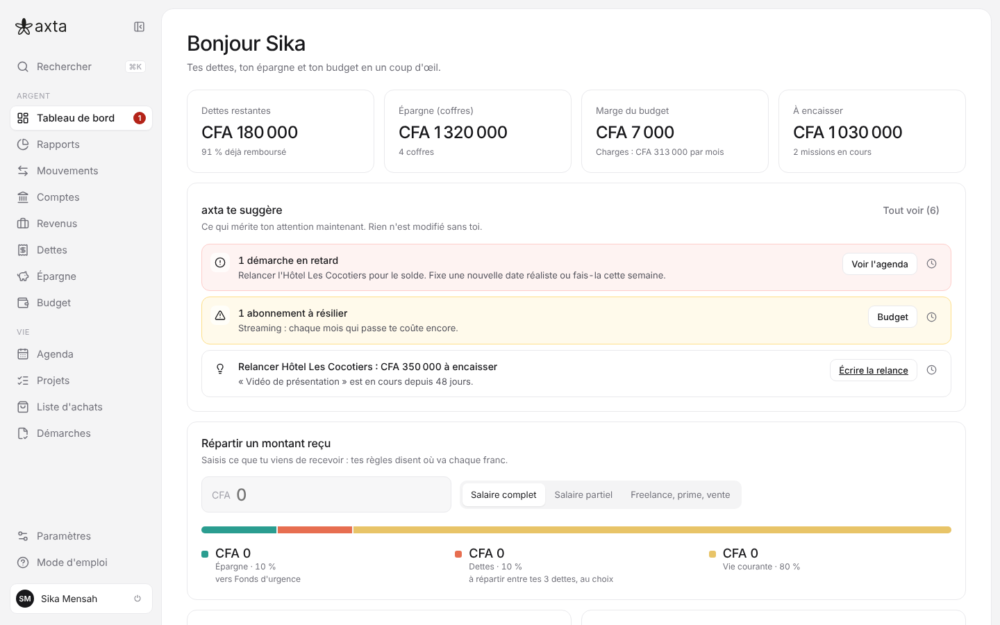

<p align="center"></p>

<p align="center"><b>Pilotage de vie local-first.</b><br>Finances, dettes, épargne, objectifs et démarches dans une seule appli installable, qui fonctionne hors ligne.</p>

<p align="center"> </p>

---

> **Version de démonstration.** Cette version d'axta sert à montrer comment l'outil fonctionne. Elle n'a pas d'espace IA, et toutes les données sont **fictives** : Sika Mensah, ses clients et ses montants n'existent pas.

## Essayer en un clic
**[Ouvrir la démo en ligne](https://padeltheguy.github.io/axta-demo/)**, puis clique « Explorer la démo ».

Tout se passe dans ton navigateur : rien n'est envoyé sur un serveur, et tu peux modifier, ajouter ou tout effacer sans risque : bouton ⏻ › « Quitter et effacer cet espace », puis « Explorer la démo » pour repartir de zéro.

## Ce qu'est axta
axta répond à une question simple : **« J'ai reçu de l'argent, où doit aller chaque franc ? »**, puis aide à suivre ce qui compte.

| Espace | Module | À quoi ça sert |
|---|---|---|
| Argent | **Tableau de bord** | Suggestions, répartiteur d'un montant reçu, ce que tu dois, encaissements sur 12 mois, prochaines échéances |
| | **Rapports** | Progression sur 3, 6, 12 mois ou plusieurs années : revenus, dépenses par catégorie, dettes remboursées, épargne, valeur nette, réalisations. Graphiques, vue tableau, export PDF |
| | **Mouvements** | Journal daté de tout l'argent qui entre et sort. Import d'un relevé Mobile Money (PDF/CSV), saisie manuelle, onglet « À classer » |
| | **Comptes** | Soldes des comptes (banque, mobile money, épargne, devises) avec la date du relevé |
| | **Revenus** | Missions, primes, ventes : acompte, solde, reste à encaisser |
| | **Dettes** | Ce que tu dois et à qui ; saisie rapide d'un versement, archive des dettes soldées |
| | **Épargne** | Un coffre par objectif et combien y verser par mois |
| | **Budget** | Charges récurrentes ramenées au mois, marge disponible |
| Vie | **Agenda** | Tout ce qui a une date, en liste ou en calendrier ; export vers Google Agenda / Apple Calendrier |
| | **Projets** | Achats importants à financer, priorisés (matrice d'Eisenhower) |
| | **Liste d'achats** | Articles repérés ; au-delà de 50 000 CFA, axta propose d'en faire un projet |
| | **Démarches** | Papiers et formalités avec échéances |

**Les règles de répartition** (Paramètres) découpent chaque rentrée d'argent : épargne, dettes, projets, plaisir, vie courante. Elles changent de **phase** : 1 « Rembourser », puis 2 « Construire » quand les dettes sont soldées.

**Autonome, sans rien décider à ta place.** À chaque ouverture, axta repère les démarches en retard, les échéances proches, une dette presque soldée, un abonnement à résilier, un client à relancer (e-mail prêt à envoyer). Les taux de change se mettent à jour seuls (l'euro est à parité fixe avec le franc CFA).

**L'historique ne se perd pas.** Chaque mois, axta fige une photo de la situation (comptes, coffres, dettes, valeur nette) ; les dettes soldées, démarches faites et projets acquis gardent leur date. Un point de restauration est créé chaque jour et avant chaque import.

## La démo : Sika, photographe freelance
Douze mois de vie financière d'une photographe et vidéaste indépendante, datés par rapport à aujourd'hui :
- **16 missions** (mariages, hôtel, ONG, festival, marques), dont une payée en euros, une en dollars, une annulée, deux en cours et un devis envoyé ;
- **4 dettes** : un crédit matériel presque soldé, un prêt familial remboursé, un micro-crédit à échéance proche, une facture d'imprimerie ;
- **4 coffres** : fonds d'urgence, impôts et cotisations, renouvellement du matériel, voyage ;
- environ **400 mouvements**, des photos mensuelles pour la courbe de valeur nette, un budget, des projets, des démarches et une liste d'achats.

Le jeu de données est dans [`src/domain/demo.ts`](src/domain/demo.ts).

## Visite guidée (10 minutes)
1. **Accueil** : « Explorer la démo ». Les données de Sika se chargent dans ton navigateur.
2. **Tableau de bord** : ce qu'axta suggère (une démarche en retard, un abonnement à résilier, un client à relancer avec un e-mail prêt). Dans « Répartir un montant reçu », tape 500 000, choisis « Freelance, prime, vente » : axta dit où va chaque franc (épargne, dettes, projets, plaisir).
3. **Rapports** : change la période (3, 6, 12 mois). Revenus et dépenses, où part l'argent, dettes et épargne, courbe de valeur nette. « Données » montre les chiffres, « Exporter en PDF » imprime le rapport.
4. **Mouvements** : un an de journal. Onglet « À classer » : un dépôt d'espèces et un virement reçu, à qualifier (ils ne comptent pas en revenus tant qu'on ne l'a pas fait).
5. **Revenus** : les missions avec acompte, solde et reste à encaisser, en CFA, en euros et en dollars.
6. **Dettes** : tape un montant dans « Verser » puis Entrée. Le versement s'enregistre, crée le mouvement daté et peut être annulé. Onglet « Remboursées » : le prêt soldé garde sa date.
7. **Épargne** et **Budget** : les coffres (dont « Impôts et cotisations », réflexe de freelance) et les charges ramenées au mois, avec la marge.
8. **Agenda** : tout ce qui a une date, en liste ou en calendrier, exportable vers Google Agenda ou Apple Calendrier.
9. **⌘K / Ctrl+K** : aller n'importe où au clavier.

**Se déconnecter** : bouton ⏻ en bas de la navigation. Sur l'écran qui suit, « Entrer » pour revenir, ou « Quitter et effacer cet espace » pour vider le navigateur et repartir de l'accueil. On peut aussi y créer son propre espace vide.

## Installer chez soi
Prérequis : [Node.js](https://nodejs.org) 20 ou plus récent.
```bash
git clone https://github.com/padeltheguy/axta-demo.git
cd axta-demo
npm ci
npm run dev          # http://localhost:5190
```
Version installable (PWA, hors ligne) : `npm run build && npm run preview` (http://localhost:4190), puis l'icône « Installer » de Chrome ou Edge.

## Comment c'est construit
- **React 19 + TypeScript + Vite**, application monopage installable (PWA, service worker).
- **Local-first** : données dans le navigateur (IndexedDB via Dexie), sauvegarde et restauration en fichier JSON, copie automatique dans un dossier (Chrome/Edge).
- **Logique métier pure et testée** dans `src/domain/` (répartition, mouvements, rapports, historique, suggestions, migrations) ; les composants ne font qu'afficher. Tests Vitest.
- Graphiques **Recharts** façon shadcn/ui, animations **Motion** (respectent « réduire les animations »), icônes **Lucide**, police Geist.
- Lecture des relevés PDF avec **pdf.js**, chargé seulement quand on importe un relevé.

```
src/
├─ app/        Accueil animé, structure (navigation repliable), palette ⌘K, automatismes
├─ features/   Pages : tableau de bord, rapports, mouvements, listes, agenda, paramètres, aide
├─ domain/     Logique métier pure + tests ; demo.ts = données fictives de la démo
├─ db/         Base locale (Dexie / IndexedDB), import-export des sauvegardes
├─ ui/         Composants partagés : tableau éditable, listes de choix, calendrier, graphiques
└─ styles/     Design tokens et styles
```

| Commande | Effet |
|---|---|
| `npm run dev` | Serveur de développement |
| `npm test` | Tests |
| `npm run typecheck` | Vérification TypeScript |
| `npm run build` | Build de production + service worker |

Raccourcis dans l'appli : **⌘K / Ctrl+K** pour aller n'importe où, **⌘B / Ctrl+B** pour replier la navigation.

## Ce qui n'est pas dans cette version
- **L'espace IA** de la version complète (assistant qui fait des bilans, lit des captures bancaires et propose des actions à confirmer).
- **Les données réelles** : uniquement le jeu fictif ci-dessus.

Voir [`CHANGELOG.md`](CHANGELOG.md) pour le contenu de la version.
